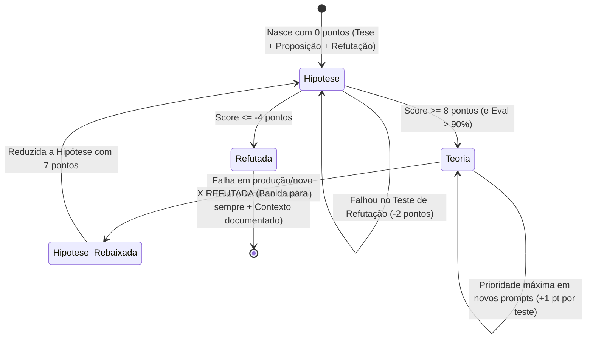

# Livro-Razão de Hipóteses Científicas de Prompts (Prompt Hypotheses Ledger)

> **Documento Oficial:** Livro-Razão Vivo de Hipóteses, Teorias e Experimentos de Engenharia de Prompts da MindFlow.  
> **Finalidade:** Centralizar o registro formal e o placar matemático de todas as hipóteses testadas no sistema, eliminando a "alquimia empírica" e garantindo total rastreabilidade científica.

---

## 🗄️ Onde e Como os Dados das Hipóteses São Armazenados

O ciclo científico de prompts armazena seus dados em três camadas complementares e desacopladas:

```
┌─────────────────────────────────────────────────────────────────────────────┐
│ 1. CAMADA DOCUMENTAL (Livro-Razão — docs/prompt_hypotheses_ledger.md)       │
│    - Registro formal de Tese, Proposição (ΔP) e Requisito de Refutação.      │
│    - Placar matemático consolidado (+1 / -2 / -4 / 7 / 8).                   │
│    - Status epistemológico (🏆 TEORIA CONSOLIDADA, 🧪 EM TESTE, ❌ REFUTADA). │
│    - Contexto detalhado e causa raiz de refutações e incidentes.             │
└──────────────────────────────────────┬──────────────────────────────────────┘
                                       │
                                       ▼ (Mapeamento Operacional)
┌─────────────────────────────────────────────────────────────────────────────┐
│ 2. CAMADA DE EVALS & QUALITY GATE (PromptOps Dedicated PostgreSQL)          │
│    - Datasets de teste persistidos via POST /api/v1/evals/datasets.         │
│    - Casos de Refutação marcados com is_refutation_case = true.             │
│    - Regras anti-contaminação (forbidden_literal_ids, forbidden_symbolic...).│
│    - Tracing de auditoria de quem criou, editou ou deletou casos de teste.  │
│    - Histórico de execuções das baterias (eval_runs / eval_results).         │
└──────────────────────────────────────┬──────────────────────────────────────┘
                                       │
                                       ▼ (Evidência Experimental Bruta)
┌─────────────────────────────────────────────────────────────────────────────┐
│ 3. CAMADA DE DADOS BRUTOS & TRACING EXPERIMENTAL (experiments/ ou scratch/) │
│    - Scripts de teste controlados em células (# %%) e assíncronos.          │
│    - Arquivos JSON brutos contendo payloads enviados e recebidos dos MCPs.   │
│    - Traces completos de inferência (tool_calls geradas, latência, tokens). │
│    - Exemplos: scratch/prompt_science_experiment_results.json.               │
└─────────────────────────────────────────────────────────────────────────────┘
```

---

## 1. Fundamentos Epistemológicos e Metodologia M-SPEM

Na engenharia de prompts da MindFlow, toda alteração em prompt obedece estritamente ao **Método Científico Hipotético-Dedutivo (Karl Popper)**.
Nenhuma linha de prompt de produção é alterada sem que haja uma hipótese formalizada neste livro-razão.

### Paralelo Estrutural: Ciência de Dados (`dados.md`) ↔ Prompt Science (`prompt_hypotheses_ledger.md`)

| Conceito em Ciência de Dados (`dados.md`) | Equivalente em Prompt Science (`prompt_hypotheses_ledger.md`) | Função no Ciclo Científico |
| :--- | :--- | :--- |
| **Problema de Negócio / Experimento MLflow** | **Domínio / Agente Alvo** (ex: `kravi_sac_whatsapp`) | Agrupa hipóteses voltadas a resolver uma classe de falhas ou comportamento de um agente. |
| **Feature Engineering / Hiperparâmetro ($\Delta X$)** | **Proposição de Mutação Estrutural ($\Delta P$)** | Uma única alteração isolada e controlada no prompt (ex: adicionar bloco `<variaveis>`, alterar tag XML, inserir CoD). |
| **Run Reprodutível + Teste Estatístico** | **Bateria de Refutação no PromptOps (Eval Run)** | Execução determinística contra casos novos/adversariais avaliados pelo LLM Judge e validação de tools MCP. |
| **Model Registry (`Staging` → `Production`)** | **Promoção a Teoria (`🏆 TEORIA`)** | Consolidação de hipótese que sobreviveu a múltiplos testes de refutação (atingindo **8 pontos** e Quality Gate `> 90%`). |
| **Registro de Falha em `memory.md` (Reflexion)** | **Cemitério de Hipóteses (`❌ REFUTADA`)** | Banimento definitivo de hipóteses que atingem **-4 pontos**, documentando exatamente o contexto e causa raiz do fracasso. |

---

## 2. Anatomia Obrigatória de uma Hipótese

Toda hipótese registrada neste livro-razão nasce com três pilares indivisíveis:

1. **Tese (Premissa Cognitiva/Computacional):** Explicação teórica de *por que* o mecanismo de atenção (Self-Attention / In-Context Learning) do LLM se comporta de determinada maneira diante do problema observado.
2. **Proposição (Intervenção Operacional — $H_1$):** Declaração clara de causa e efeito: *"Ao aplicar a alteração estrutural [X] no prompt, a IA passará a executar o comportamento [Y] mesmo diante de novos casos [Z]."*
3. **Requisito de Refutação (Critério de Falseabilidade de Popper):**
   - Define o **Experimento de Refutação**: um teste com **Eval em caso novo (out-of-distribution / adversarial)** desenhado especificamente para tentar fazer a hipótese falhar.
   - **Regra de Interpretação do Teste de Refutação:**
     - **Se a tentativa de refutação falhar em quebrar o prompt** (o Eval no caso novo **PASSA** sem alucinar ou vazar dados): a hipótese ganha **`+1 ponto`**.
     - **Se a tentativa de refutação tiver sucesso em quebrar o prompt** (o Eval no caso novo **REPROVA**): a hipótese perde **`-2 pontos`**.

---

## 3. Mecânica Matemática de Pontuação, Ranking e Ciclo de Vida



### Regras de Pontuação:
- **Nascimento:** Toda nova hipótese inicia com **`0 pontos`**.
- **Aprovação em Teste de Refutação (`+1 ponto`):** Ganha **`+1 ponto`** a cada caso novo de refutação superado com sucesso.
- **Erro em Teste de Refutação (`-2 pontos`):** Perde **`-2 pontos`** a cada falha (penalidade assimétrica 2:1 popperiana).
- **Promoção a Teoria (`>= 8 pontos`):** Promovida a **`🏆 TEORIA CONSOLIDADA`** ao atingir 8 pontos e Quality Gate `> 90%` no PromptOps.
- **Morte Científica (`<= -4 pontos`):** Declarada **`❌ REFUTADA`**, banida permanentemente de todos os prompts e documentada no arquivo morto.
- **Governança de Falha de Teoria (Regra dos 7 Pontos):** Se uma Teoria falhar em um teste extremo ou incidente de produção, o agente **deve comunicar imediatamente ao usuário** e recomendar **reduzi-la a hipótese novamente com `7 pontos`**, exigindo superação de um novo teste de refutação (`7 + 1 = 8`) para reabilitar seu status.

---

## 4. Livro-Razão Ativo de Hipóteses & Teorias

### 🏆 4.1. Teorias Consolidadas (Prioridade Máxima)

#### `T-01` — Isolamento de Estado por Variáveis Simbólicas (`<variaveis>`) + Few-Shot Estrutural com CoD
- **Pontuação Atual:** **`8 pontos`** (Promovida a Teoria em 2026-10-20 — Quality Gate: `100%`)
- **Autor / Responsável:** Engenheiro de Prompt & Cientista Experimental
- **Tese:** Em arquiteturas Transformer, exemplos *few-shot* literais criam atratores de atenção espúrios (*anchoring bias*). Ao substituir valores literais nos exemplos e regras por ponteiros simbólicos entre colchetes (`[singleUserId]`, `[singleAccountId]`, `[unitId]`) mapeados em `<variaveis>`, o modelo aprende a **topologia da chamada de ferramenta** sem memorizar dados antigos.
- **Proposição:** Definir bloco `<variaveis>` no topo e estruturar exemplos em `<few_shot_declarado>` contendo `<estado_sessao_anterior>`, `<raciocinio_interno_cod>` e `<chamada_ferramenta>` exclusivamente com variáveis simbólicas `[var]`.
- **Requisito de Refutação:** Submeter a Evals com novos moradores e condomínios inéditos (Carlos no Condomínio Solar; Fernanda no Condomínio Horizonte). Aprovada sem vazamento de IDs literais.
- **Evidência Empírica:** Runs 1..5 (`eval_few_shot_result.json`) + Runs 6..8 (`scratch/experiment_prompt_science.py`).
- **🛡️ Teorema de Preservação de Contexto MCP:**
  - Em fluxos com chamadas MCP encadeadas, a resolução de variáveis dinâmicas depende de o histórico conter as mensagens de retorno da tool (`role: 'tool'`). O worker de mensageria deve injetar o payload retornado da tool de identificação no histórico do chat para resolução determinística.

---

### 📊 4.2. Ranking de Hipóteses em Teste

| Posição | ID | Hipótese (Resumo) | Pontuação Atual | Status | Próximo Teste de Refutação |
| :---: | :---: | :--- | :---: | :---: | :--- |
| **1º** | **`H-04`** | **Explicitação de Protocolo de API por Contraste Sintático (`@` vs `null`/`""`)** | **`+3 pts`** | 🧪 Em Teste | Testar em visitas recorrentes (`tpVisit='Permanente'`) e áreas comuns (`commonAreaId` ativo e `unitId='@'`). |
| **2º** | **`H-03`** | **Guardrail de Re-hidratação Silenciosa de Estado (`getUserByPhone` sob demanda se `[singleAccountId]` for nulo)** | **`+1 pt`** | 🧪 Em Teste | Testar em conversas iniciadas no Turno 3 após limpeza de memória (`clean_chat_history`). |

#### Detalhamento:
- **`H-04` (`+3 pts`):** Proíbe `null`, `None`, `undefined` e `""` contrastando com erro `400 Bad Request` e instrui uso de `'@'` para campos não aplicáveis da API do Situator.
- **`H-03` (`+1 pt`):** Proíbe envio do nome textual da variável simbólica (ex: `"singleAccountId"`) para a tool se ela estiver vazia, forçando re-execução silenciosa de `getUserByPhone`.

---

### ❌ 4.3. Hipóteses Refutadas (Arquivo Morto — Proibição Permanente)

#### `H-01` — ❌ X REFUTADA: Few-Shot com Valores Literais de Casos Antigos
- **Pontuação Final:** **`-4 pontos`** (Banida permanentemente em 2026-10-20)
- **Tese Original:** Copiar exemplos reais de um caso antigo bem-sucedido ajudaria o modelo por in-context learning.
- **Evidência da Falha:** No Caso `REF-01` (Mariana), acionou `getSchedulingAreaOptions` com IDs do caso antigo Renato (`1277`, `275983`) (-2 pts). No Caso `REF-02` (Carlos), agendou visita dentro do apartamento do Renato no condomínio antigo (-2 pts, total -4 pts).
- **Causa Raiz:** *Anchoring bias* / *in-context overfitting*. O LLM ancora nos números literais do prompt e vaza dados entre clientes (Cross-Tenant Data Leakage).
- **Substituta:** Substituída definitivamente pela Teoria **`T-01`**.
