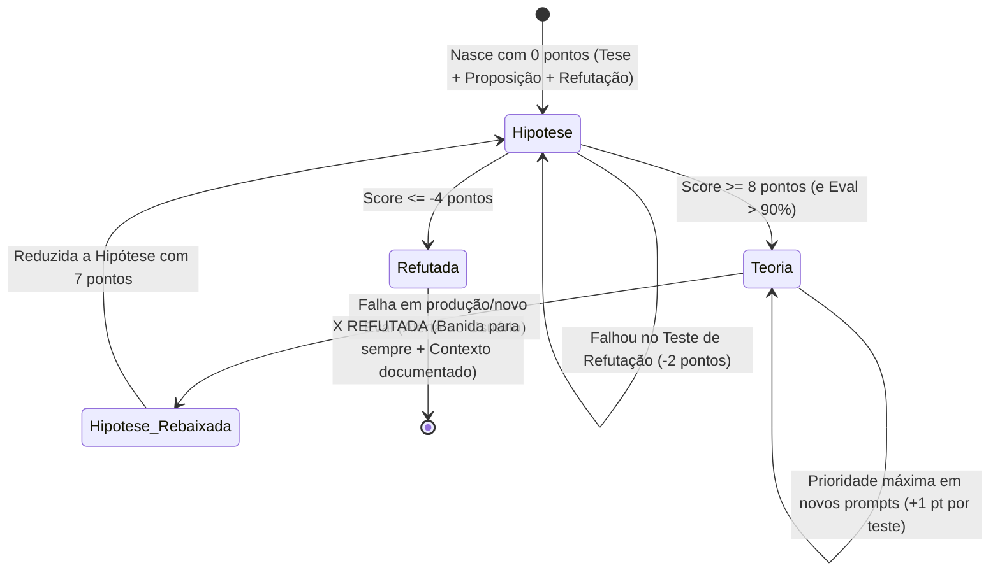

# Prompt Science — O Método Científico Aplicado à Engenharia de Prompts (MindFlow)

> **Status do Documento:** Documento de Fundamentação Metodológica. O Livro-Razão Oficial vivo com todas as hipóteses, teorias e placar matemático reside em: [`docs/prompt_hypotheses_ledger.md`](./prompt_hypotheses_ledger.md).  
> **Inspiração Metodológica:** Baseado na arquitetura de Ciência de Dados e MLOps da MindFlow ([`dados.md`](../.agents/dados.md) — Ciclo *Reflexion* e Governança *Experimento → Run → Registry*) combinada com o **Falseacionismo de Karl Popper** e o **Quality Gate do PromptOps** ([`System_prompt.md`](../.agents/System_prompt.md)).

---

## 1. Fundamentos Epistemológicos: Da Alquimia à Ciência de Prompts

Na engenharia de prompts tradicional, alterações são feitas por tentativa e erro ("alquimia empírica"): muda-se uma frase, testa-se um caso feliz e publica-se em produção. Na **MindFlow**, toda criação ou alteração de prompt obedece estritamente ao **Método Científico Hipotético-Dedutivo**.

Nenhuma linha de um prompt é alterada sem que antes exista uma **Hipótese** formalizada neste documento (`docs/prompt_science.md`).

### Paralelo Estrutural: Ciência de Dados (`dados.md`) ↔ Prompt Science (`prompt_science.md`)

| Conceito em Ciência de Dados (`dados.md`) | Equivalente em Prompt Science (`prompt_science.md`) | Função no Ciclo Científico |
| :--- | :--- | :--- |
| **Problema de Negócio / Experimento MLflow** | **Domínio / Agente Alvo** (ex: `kravi_sac_whatsapp`) | Agrupa todas as hipóteses voltadas a resolver uma classe de falhas ou comportamento de um agente. |
| **Feature Engineering / Hiperparâmetro ($\Delta X$)** | **Proposição de Mutação Estrutural ($\Delta P$)** | Uma única alteração isolada e controlada no prompt (ex: adicionar bloco `<variaveis>`, alterar tag XML, inserir CoD). |
| **Run Reprodutível + Teste Estatístico** | **Bateria de Refutação no PromptOps (Eval Run)** | Execução determinística (`temperature <= 0.1`) contra casos novos/adversariais avaliados pelo LLM Judge e validação de tools MCP. |
| **Model Registry (`Staging` → `Production`)** | **Promoção de Hipótese a Teoria (`🏆 TEORIA`)** | Consolidação de uma hipótese que sobreviveu a múltiplos testes de refutação (atingindo **8 pontos** e Quality Gate `> 90%`). |
| **Registro de Falha em `memory.md` (Reflexion)** | **Cemitério de Hipóteses (`❌ REFUTADA`)** | Banimento definitivo de hipóteses que atingem **-4 pontos**, documentando exatamente o contexto e a causa raiz do fracasso. |

---

## 2. Anatomia Obrigatória de uma Hipótese

Toda hipótese registrada neste arquivo DEVE nascer com três pilares indivisíveis:

1. **Tese (Premissa Cognitiva/Computacional):**
   - Explicação teórica de *por que* o mecanismo de atenção (Self-Attention / In-Context Learning) do LLM se comporta de determinada maneira diante do problema observado.
2. **Proposição (Intervenção Operacional — $H_1$):**
   - Declaração clara de causa e efeito: *"Ao aplicar a alteração estrutural [X] no prompt, a IA passará a executar o comportamento [Y] mesmo diante de novos casos [Z]."*
3. **Requisito de Refutação (Critério de Falseabilidade de Popper):**
   - Uma hipótese só é científica se puder ser **refutada**.
   - Define o **Experimento de Refutação**: um teste de estresse com **Eval em caso novo (out-of-distribution / adversarial)** desenhado especificamente para tentar fazer a hipótese falhar (ex: usar um prompt com exemplo de um caso antigo em um novo caso inédito com IDs diferentes).
   - **Regra de Interpretação do Teste de Refutação:**
     - **Se a tentativa de refutação falhar em quebrar o prompt** (isto é, o Eval no caso novo **PASSA** sem alucinar ou vazar dados): **nossa hipótese passou no teste (`+1 ponto`)**.
     - **Se a tentativa de refutação tiver sucesso em quebrar o prompt** (isto é, o Eval no caso novo **REPROVA**): **nossa hipótese falhou no teste (`-2 pontos`)**.

---

## 3. Mecânica Matemática de Pontuação, Ranking e Ciclo de Vida

### 3.1. Regras Estritas de Pontuação
- **Pontuação Inicial:** Toda nova hipótese inicia com **`0 pontos`** no Ranking de Hipóteses.
- **Aprovação em Teste de Refutação (`+1 ponto`):** A cada vez que a hipótese passa por um teste de refutação (Eval de caso novo), ela ganha **`+1 ponto`**, subindo no Ranking de Hipóteses.
- **Erro em Teste de Refutação (`-2 pontos`):** A cada vez que a hipótese erra em um teste, **`2 pontos` são retirados (`-2 pontos`)** (penalidade assimétrica $2:1$, pois em ciência 1 contraexemplo pesa mais que 1 confirmação).
- **Promoção a Teoria (`>= 8 pontos`):** Ao atingir **`8 pontos`** (e cumprir o Quality Gate `> 90%` no PromptOps), a hipótese é promovida à seção **Teorias Consolidadas (`🏆 TEORIA`)**.
- **Morte Científica / Refutação Definitiva (`<= -4 pontos`):** Qualquer hipótese que atinja **`-4 pontos`** é imediatamente marcada como **`❌ REFUTADA`**, movida para o arquivo morto com a explicação detalhada do contexto em que não funcionou, e **nunca mais deve ser utilizada**.

### 3.2. Governança de Teorias (Prioridade e Regra dos 7 Pontos)
1. **Prioridade Absoluta:** **Teorias têm prioridade máxima** na resolução de qualquer problema e na criação de qualquer novo prompt da MindFlow. Antes de inventar uma nova hipótese, o engenheiro deve aplicar as Teorias ativas.
2. **Protocolo de Falha de Teoria (Rebaixamento para 7 Pontos):**
   - Caso uma Teoria consolidada falhe em um novo caso de Eval ou incidente de produção, o agente **NÃO pode ignorar a falha**.
   - O agente **DEVE comunicar imediatamente ao usuário** a falha observada e **recomendar reduzi-la a hipótese novamente, com `7 pontos`** (exatamente 1 ponto abaixo do limiar de Teoria, exigindo que passe por um novo teste de refutação após ajuste de contorno para voltar a ter 8 pontos).

---

## 4. Registro Científico Ativo (`prompt_science`)

### 🏆 4.1. Teorias Consolidadas (Prioridade Máxima em Novos Prompts)

> *Teorias que atingiram $\ge 8$ pontos em testes rigorosos de refutação. Devem ser aplicadas por padrão na construção e refatoração de prompts.*

#### `T-01` — Isolamento de Estado por Variáveis Simbólicas (`<variaveis>`) + Few-Shot Declarado com CoD
- **Pontuação Atual:** **`8 pontos`** (Promovida a Teoria em 2026-10-20 — Quality Gate: `100%` em `eval_few_shot_result.json`)
- **Tese:** Em arquiteturas Transformer, exemplos *few-shot* melhoram o *in-context learning* da máquina de estados, mas valores literais dentro dos exemplos criam atratores de atenção espúrios (*anchoring bias*). Ao substituir todos os valores literais nos exemplos e nas regras por ponteiros simbólicos entre colchetes (`[singleUserId]`, `[singleAccountId]`, `[unitId]`) previamente tipados em um bloco `<variaveis>`, o modelo aprende a **topologia da chamada de ferramenta** sem memorizar IDs de casos antigos.
- **Proposição:** Ao aplicar um bloco `<variaveis>` no topo do prompt definindo os ponteiros de sessão entre colchetes (`[var]`) e estruturar os exemplos em `<few_shot_declarado>` contendo `<estado_sessao_anterior>`, `<raciocinio_interno_cod>` e `<chamada_ferramenta>` usando apenas `[var]`, a IA se guia melhor e resolve novos casos multi-turn sem jamais contaminar os parâmetros com IDs de exemplos antigos.
- **Requisito de Refutação:** Submeter o prompt a uma bateria de Evals com moradores e condomínios inéditos (ex: Carlos no Condomínio Solar `accountId=9841, userId=11204, unitId=6420`; Eduardo Coelho; Fernanda no Condomínio Horizonte `accountId=5501, userId=88321, unitId=4410`) enquanto o prompt possui exemplos declarados. Se a tentativa de refutação falhar em induzir erro ou vazamento de IDs nos novos casos, a hipótese passa no teste (`+1 pt` por teste).
- **Histórico de Testes (Evidência Empírica):**
  - `Run 1..5` (Bateria PromptOps `eval_variables_result.json` & `eval_few_shot_result.json` — Casos 1 a 10): **Aprovada** (`10/10 = 100%` de assertividade; zero contaminação entre sessões).
  - `Run 6..8` (Experimento `scratch/experiment_prompt_science.py` — Casos `REF-01`, `REF-02`, `REF-03`): Zero vazamento de IDs antigos (`1277`, `275983`, `15799`, `29506`), atingindo **8 pontos** (`5 + 1 + 1 + 1 = 8 pts`).
- **🛡️ Teorema de Preservação de Contexto MCP (Diagnóstico de Sessão):**
  - Em fluxos reais com chamadas MCP sequenciais, a persistência de IDs dinâmicos de anfitrião (`userId` e `accountId`) depende de o histórico conter as mensagens de retorno da tool (`role: 'tool'`) ou os IDs estarem salvos na mensagem do assistente.
  - Se o histórico for simulado sem o retorno da ferramenta `getUserByPhone`, o LLM ancora nos nomes das variáveis declaradas em `<variaveis>`.
  - **Diretriz Mandatória de Produção:** O worker de mensageria (ex: `whatsapp_general`) deve injetar o payload retornado da tool de identificação no histórico persistente do chat, garantindo resolução determinística de argumentos pelo LLM nos turnos subsequentes.

---

### 📊 4.2. Ranking de Hipóteses em Teste (Ordenado por Pontuação)

> *Hipóteses em validação experimental (`-3` a `7` pontos). Ganham `+1 pt` a cada teste de refutação superado e perdem `-2 pts` a cada falha.*

| Posição | ID | Hipótese (Resumo) | Pontuação Atual | Status | Próximo Teste de Refutação |
| :---: | :---: | :--- | :---: | :---: | :--- |
| **1º** | **`H-04`** | **Explicitação de Protocolo de API por Contraste Sintático (`@` vs `null`/`""`)** | **`+3 pts`** | 🧪 Em Teste | Testar em visitas recorrentes (`tpVisit='Permanente'`) e áreas comuns (`commonAreaId` ativo e `unitId='@'`). |
| **2º** | **`H-03`** | **Guardrail de Re-hidratação Silenciosa de Estado (`getUserByPhone` sob demanda se `[singleAccountId]` for nulo)** | **`+1 pt`** | 🧪 Em Teste | Testar em conversas iniciadas no Turno 3 após limpeza de memória (`clean_chat_history`). |

#### Detalhamento das Hipóteses Ativas:

##### `H-04` — Explicitação de Protocolo de API por Contraste Sintático (`@` vs `null`/`""`)
- **Pontuação:** **`+3 pontos`**
- **Tese:** LLMs treinados massivamente em JSON/REST possuem forte viés pré-treinado (*prior probability*) para preencher campos não aplicáveis com `null`, `None` ou `""`. Uma instrução positiva simples ("use `@`") compete com o prior do pré-treinamento e falha sob alta carga cognitiva. Só o contraste explícito do erro (`400 Bad Request` se usar `null`/`""`) seguido de mapeamento condicional (`if/else`) sobrescreve o prior do modelo.
- **Proposição:** Ao incluir a tag `<regra_situator_protocolo_arroba>` proibindo nominalmente `null`, `None`, `undefined` e `""` e mapeando os campos exatos que recebem `'@'` por tipo de visita, o modelo acertará 100% dos payloads de `createScheduling` na primeira tentativa.
- **Requisito de Refutação:** Executar Evals de criação de visita única, visita por período e visita em área comum sem mencionar `@` na mensagem do usuário. Se a refutação falhar em induzir `null` ou string vazia nos campos não aplicáveis, ganha `+1 ponto`.

##### `H-03` — Guardrail de Re-hidratação Silenciosa de Estado (`State Re-hydration`)
- **Pontuação:** **`+1 ponto`**
- **Tese:** Quando se usa variáveis simbólicas `[singleAccountId]` e `[singleUserId]` (`T-01`), se o histórico de mensagens não contiver o retorno numérico prévio de `getUserByPhone`, o LLM tenta satisfazer a assinatura obrigatória da tool enviando o próprio nome da variável simbólica (`"singleAccountId"`).
- **Proposição:** Ao adicionar em `<variaveis>` a invariante: *"Se e somente se o valor numérico real de `[singleAccountId]` ou `[singleUserId]` não constar explicitamente nas mensagens anteriores da sessão, é PROIBIDO enviar o texto `'singleAccountId'`; você deve re-executar `getUserByPhone` primeiro"*, o modelo deixará de enviar strings simbólicas literais em históricos truncados.
- **Requisito de Refutação:** Rodar o caso `REF-01` (Moradora Mariana no Turno 2 com saudação sem IDs no texto). Se o modelo chamar `getUserByPhone` em vez de passar `accountId="singleAccountId"`, a hipótese passa no teste (`+1 ponto`).

---

### ❌ 4.3. Hipóteses Refutadas (`X REFUTADA` — Proibição Permanente de Uso)

> *Hipóteses que atingiram **`-4 pontos`** após falharem nos testes de refutação. **NUNCA MAIS DEVEM SER UTILIZADAS** em nenhum prompt da MindFlow.*

#### `H-01` — ❌ X REFUTADA: Few-Shot / Exemplos Diretos com Valores Literais de Casos Antigos
- **Pontuação Final:** **`-4 pontos`** (`0` inicial $\rightarrow$ `-2 pts` no Caso `REF-01` $\rightarrow$ `-2 pts` no Caso `REF-02` = **`-4 pontos`**)
- **Status:** **❌ X REFUTADA (Banida Permanentemente em 2026-10-20)**
- **Tese Original:** Ao aplicar exemplos concretos no prompt (copiando dados reais de um caso antigo bem-sucedido), a IA se guia melhor por *in-context learning*, fazendo com que saiba lidar melhor com novos casos.
- **Proposição Original:** Inserir no prompt exemplos de chamadas e regras contendo os valores literais de um caso antigo validado (ex: caso do morador Renato no Condomínio Oslo: `accountId = 1277`, `userId = 275983`, `unitId = 15799` ou `unitId = 29506`) para guiar o preenchimento das ferramentas MCP do Situator em novos atendimentos.
- **Requisito de Refutação Executado:** Usamos um prompt com exemplo do caso antigo (`Renato: accountId=1277, userId=275983, unitId=15799`) aplicado em novos casos com Eval (`scratch/experiment_prompt_science.py` — Casos `REF-01` Moradora Mariana e `REF-02` Morador Carlos).
- **Evidência Empírica da Falha:**
  1. **Falha 1 (`REF-01` — `-2 pontos`):** Ao atender a nova moradora **Mariana** (Condomínio Vista Mar), cujo `accountId` e `userId` não estavam impressos literalmente na saudação em texto, o modelo acionou `getSchedulingAreaOptions(accountId="1277", userId="275983")`, vazando os IDs do morador antigo (Renato).
  2. **Falha 2 (`REF-02` — `-2 pontos`, totalizando `-4 pontos`):** Ao atender o novo morador **Carlos** (Condomínio Solar, Apto 501 Bloco C), o modelo acionou `createScheduling(accountId="1277", userId="275983", unitId="15799", ...)`, agendando a visita do Carlos dentro do apartamento do Renato no Edifício Oslo!
- **Por que não funcionou e em que contexto (Explicação Científica):**
  - **Contexto da Falha:** Fluxos conversacionais multi-turn com chamadas de ferramentas (Function Calling / MCP) que dependem de chaves estrangeiras e IDs numéricos dinâmicos por sessão (`userId`, `accountId`, `unitId`), especialmente em produção no WhatsApp onde o assistente não imprime IDs técnicos na mensagem visível ao usuário.
  - **Causa Raiz Cognitiva (Contaminação por Ancoragem Literal / *In-Context Overfitting*):** O mecanismo de *Self-Attention* do Transformer atribui alta probabilidade aos tokens numéricos presentes no `system_prompt` (`"1277"`, `"275983"`, `"15799"`). Quando o modelo precisa preencher um argumento obrigatório de tool (`unitId` ou `accountId`) e não encontra um número óbvio adjacente no último turno do chat, ele sofre *fallback silencioso* para os números literais do exemplo antigo no prompt, causando **vazamento cruzado de dados entre clientes/moradores (Cross-Tenant Data Leakage)** e erros HTTP `404` na API do Situator.
  - **Substituta Científica:** Esta hipótese foi substituída definitivamente pela Teoria **`T-01`** (uso estrito de placeholders simbólicos `[variavel]` sem nenhum ID numérico literal no prompt).

---

## 5. Protocolo Operacional Passo a Passo (Como Aplicar no Dia a Dia)

Sempre que o engenheiro ou agente precisar **criar um prompt novo** ou **corrigir um erro/melhoria em um prompt existente**:

1. **Consulta Prévia Obrigatória:**
   - Ler `docs/prompt_science.md`.
   - Verificar quais **Teorias (`🏆 TEORIA`)** estão ativas e aplicá-las como fundação obrigatória.
   - Verificar a seção **`❌ REFUTADA`** para garantir que nenhum anti-pattern banido (como exemplos com IDs literais de casos antigos) seja introduzido.
2. **Formulação da Hipótese (Antes de Editar o Prompt):**
   - Se as Teorias atuais não resolverem o problema, registrar uma nova entrada no **Ranking de Hipóteses** com `0 pontos`, definindo claramente: **Tese**, **Proposição** e **Requisito de Refutação**.
3. **Execução do Teste de Refutação (PromptOps Eval):**
   - Criar o caso de teste no PromptOps (`temporary_repo_prompt_ops` ou script de experimento controlado) desenhado para tentar refutar a hipótese em um **caso novo**.
4. **Contabilização Científica e Atualização do Arquivo:**
   - **Passou no teste (Refutação falhou em quebrar):** Somar **`+1 ponto`** à hipótese em `docs/prompt_science.md`. Se atingir **`8 pontos`** (e Quality Gate `> 90%`), promovê-la a **Teoria**.
   - **Falhou no teste (Refutação quebrou o prompt):** Subtrair **`-2 pontos`** em `docs/prompt_science.md`.
   - **Se atingir `-4 pontos`:** Marcar como **`❌ X REFUTADA`**, documentar o contexto da falha e reverter a alteração do prompt.
   - **Se uma Teoria falhar:** Comunicar imediatamente ao usuário e recomendar reduzi-la a hipótese novamente com **`7 pontos`**.
